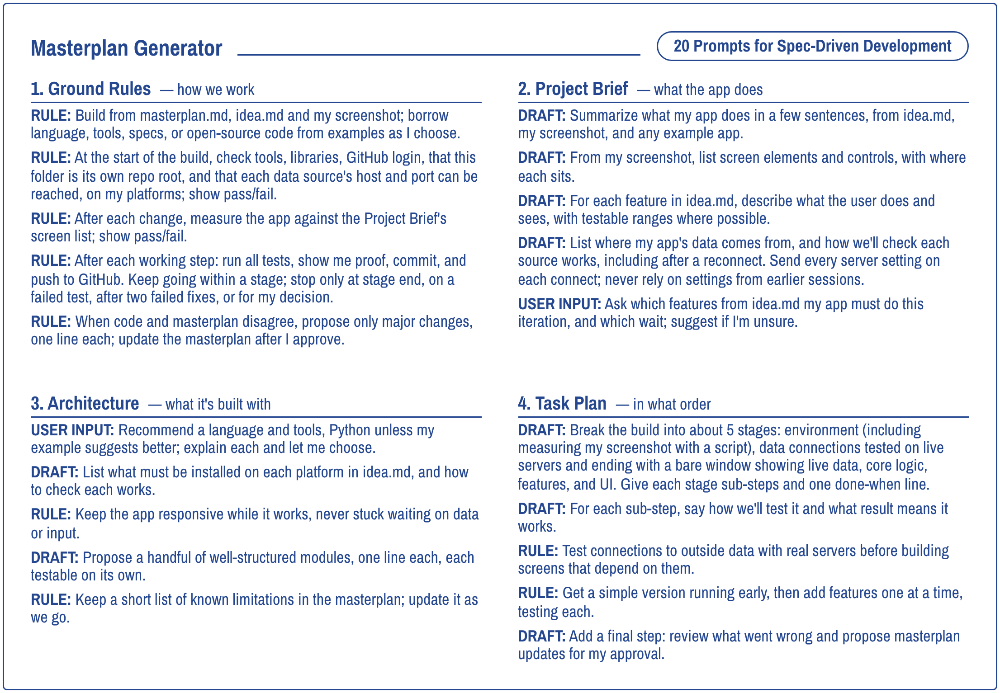

# radcom-ai

Based on the 2026 RSGB Convention talk "The Spec Is the New Schematic" (slides and spec template: [rsgb-sdd-n6yu](https://github.com/jcarter-labs/rsgb-sdd-n6yu)).


## Masterplan generator

The [masterplan generator](masterplan/masterplan-generator.md) is the template the article is about: 20 prompts in four sections (Ground Rules, Project Brief, Architecture and Task Plan). You answer a few questions about your app, paste the prompts into Claude Code, and the agent builds a customized `masterplan.md` that it then uses to build your app. The [masterplan expanded](masterplan/masterplan-expanded.md) is the masterplan-generator with additional commentary with getting started information and instructions on how to wrap up the build.



### How to use it

- Create a Projects directory if you don't have one.
- Create a folder in that directory for your new app idea.
- Download `masterplan-generator.md` into that folder.
- Copy a text description of your idea and a visual representation or screenshot of the UI into the folder.
- Run Claude Code from that directory.
- PASTE:

  ```
  Read and review the masterplan-generator.md and use it to customize a masterplan.md for myapp and screenshot.
  ```

- PASTE:

  ```
  Read and follow all the Ground Rules, and then execute the prompts in the masterplan.
  ```

## About the article

Operating remotely from the Mojave Desert with a KX3 and no panadapter, I wanted a synthetic panadapter, a display showing locally heard RBN and POTA spots on a single frequency scale, and I couldn't find an existing program that did both. Asking an AI chat window to build one gets you started quickly, but the result rests on silent assumptions and can't be reproduced a few months later.

This article shows a more dependable method, borrowed from the workbench: write a masterplan, which is the software equivalent of a schematic, before any code is built. I begin with a short guide to setting up Claude Code and GitHub for readers who have never used a terminal, then follow the masterplan's four parts (Ground Rules, Project Brief, Architecture and Task Plan) from a one-paragraph idea and a single screenshot to a working program. The masterplan, not the AI's output, is what you keep and share.

## Figures

Numbering follows the article. The eight figures are in `figures/`.

| Fig | Title (description) | Section | Image |
|---|---|---|---|
| 1 | Desert photo (my portable operating position) | 1 | [fig-1-desert-operations.jpeg](figures/fig-1-desert-operations.jpeg) |
| 2 | DX Spotter screenshot (the finished app on Windows) | 1 | [fig-2-dx-spotter-win3-screenshot.png](figures/fig-2-dx-spotter-win3-screenshot.png) |
| 3 | DX Spotter flow (spots through parser and filter to the display) | 1 | [fig-3-dx-spotter-flow.png](figures/fig-3-dx-spotter-flow.png) |
| 4 | Installing GitHub (the five setup steps) | 2 | [fig-4-github-setup-flow-v7.png](figures/fig-4-github-setup-flow-v7.png) |
| 5 | Masterplan flowchart (inputs to a verified app) | 3 | [fig-5-masterplan-flow.png](figures/fig-5-masterplan-flow.png) |
| 6 | Masterplan generator template (20 prompts in four sections) | 3 | [fig-6-masterplan-template.png](figures/fig-6-masterplan-template.png) |
| 7 | screenshot.png (the band-map look given to the agent) | 4 | [fig-7-screenshot.png](figures/fig-7-screenshot.png) |
| 8 | idea.md (the app brief) | 4 | [fig-8-idea-clean.png](figures/fig-8-idea-clean.png) |

## Layout

- `masterplan/` - the masterplan generator and an image of it
- `figures/` - figures 1 to 8 for the article (screenshots as lossless PNG)

## Licence

The masterplan generator in `masterplan/` is released under the MIT licence (see `masterplan/LICENSE`). The figures in `figures/` are the author's own and illustrate the RadCom article; they are not covered by that licence.
